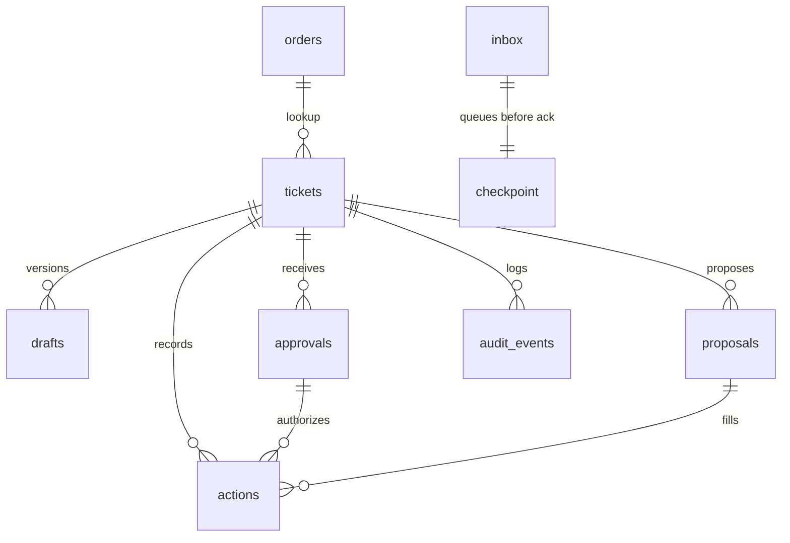

# Database design — Refund Desk

SQLite via `node:sqlite`, file `data/refund-desk.sqlite`, WAL, foreign keys on. The file is gitignored. There is no full-text table.

## ER

## Tables

### `orders`

`id` TEXT PK, `customer_name` TEXT, `email` TEXT, `amount_inr` INTEGER, `charge_count` INTEGER, `status` TEXT (`paid` or `refund_recorded`), `placed_on` TEXT (`YYYY-MM-DD`).

### `policy_clauses`

`id` TEXT PK, `heading` TEXT, `body` TEXT. Exactly three rows: `duplicate-charge`, `window`, `not-received`. Always loaded together.

### `tickets`

| Column | Notes |
| --- | --- |
| `id` TEXT PK | |
| `room_id` TEXT | |
| `thread_id` TEXT NOT NULL | Opening `thread_id`, or the opening `message_id` when the root thread is null. |
| `source_message_id` TEXT UNIQUE | |
| `order_id` TEXT | FK, nullable only while asking for an id. |
| `label` TEXT | `refund` or `question`. |
| `eligibility` TEXT | `eligible` or `ineligible`. From code. |
| `status` TEXT | `awaiting_approval`, `partially_executed`, `closed`. |
| `summary` TEXT | |
| `proposal_version` INTEGER | Starts at 1. Increments when the draft is replaced. |
| `finance_note` TEXT | Set only in the `flag_finance` transaction. |
| `created_at` TEXT | |

`partially_executed` means at least one proposal is `executed` and at least one is still `pending`. A proposal that was never created is not a denied action.

### `drafts`

`id`, `ticket_id`, `proposal_version`, `customer_reply`, `internal_note`, `created_at`. Unique `(ticket_id, proposal_version)`.

### `draft_citations`

`draft_id`, `chunk_id`, `accepted` INTEGER. Primary key `(draft_id, chunk_id)`. `accepted=0` keeps the rejected id out of the thread and in the audit payload. No foreign key on `chunk_id`, so an unknown id can be stored as rejected.

### `proposals`

`id`, `ticket_id`, `proposal_version`, `action` (`send_reply`, `flag_finance`, `issue_refund`), `status` (`pending` or `executed`). Unique `(ticket_id, proposal_version, action)`.

### `approvals`

`id`, `ticket_id`, `message_id` UNIQUE, `thread_id` TEXT NOT NULL, `sender_id` TEXT NOT NULL, `proposal_version` INTEGER NOT NULL, `verbatim`, `actions_json`, `invalidated_at` TEXT nullable, `created_at`.

A new draft sets `invalidated_at` on approvals whose version is older.

### `actions`

`id`, `ticket_id`, `proposal_id`, `approval_id`, `action`, `outcome` (`executed` only on the success path), `reason` (the simulated label), `simulated` INTEGER NOT NULL default 1, `created_at`.

Unique on `proposal_id` where `outcome='executed'`. Denied attempts are audit rows, not action rows, so a later valid approval can still execute that proposal.

### `inbox`

| Column | Notes |
| --- | --- |
| `id` INTEGER PK | |
| `sequence` INTEGER | Null for a gap record. Unique together with `cursor_epoch`, not across a numbering reset. |
| `message_id` TEXT | Unique when not null. |
| `kind` TEXT | `message` or `gap`. |
| `payload_json` TEXT | |
| `state` TEXT | `queued`, `processing`, `completed`, `failed`. |
| `attempts` INTEGER | |
| `queued_at`, `started_at`, `finished_at` | |

Inserting a row does not mean the work finished. Skip a duplicate only when `state='completed'`.

### `checkpoint`

One row, `id=1`. `queued_sequence` is the last domain sequence durably received. `resume_sequence` is the socket cursor: the last received sequence, or `gap.resumed_at` after a gap. `cursor_epoch` increments on each gap. A gap does not change `queued_sequence`.

### `audit_events`

`id` INTEGER PK, `ticket_id`, `kind`, `payload_json`, `created_at`.

Kinds include `approval_rejected`, `citation_rejected`, `draft_stored`, `action_executed`, `model_failed`, `gap`.

### `llm_calls`

`id`, `ticket_id`, `provider` (`live` or `scripted`), `model`, `prompt_hash`, `response_json`, `latency_ms`, `created_at`. The prompt text is not stored.

### `schema_migrations`

`version` INTEGER PK, `applied_at` TEXT.

## Seed

Idempotent inserts.

| Order | Row | Code result |
| --- | --- | --- |
| `4821` | Asha Menon, `asha@example.com`, ₹1299, two charges, `paid`, `2026-11-04` | Eligible duplicate. Three proposals. |
| `1008` | Two charges, `2026-07-01` | Ineligible. Propose `send_reply` only. |
| `2204` | One charge, `2026-11-05` | `question`. Propose `send_reply` only. |

`DEMO_TODAY` defaults to `2026-11-06`.

Clauses:

- `duplicate-charge` — Refund the duplicate charge, not the original. Tell the customer. Flag finance.
- `window` — The duplicate-charge rule lasts 30 days from `placed_on`.
- `not-received` — A single charge with a missing parcel is a question, not a refund.

## Migrations

`db/migrations/001_init.sql` applied by `npm run db:migrate`. Reset with deleting the gitignored file.
