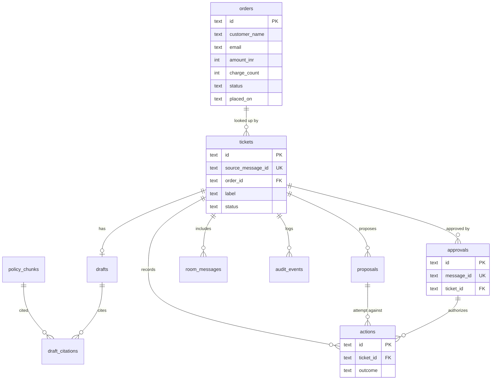

# Database design — Refund Desk

SQLite, one file at `data/refund-desk.sqlite`, WAL mode. The agent is the only writer. The board reads through the agent's HTTP API, not by opening the file, so the Next process does not need a SQLite binding.

No Postgres and no pgvector. The policy is three short chunks. FTS5 is enough, and it runs with the seed.

## ER

## Tables

Types are SQLite affinities. Times are ISO-8601 UTC text. Money is integer INR paise not needed; seed amounts are whole rupees.

### `orders`

| Column | Type | Notes |
| --- | --- | --- |
| `id` | TEXT PK | `"4821"`. Not an autoincrement. |
| `customer_name` | TEXT NOT NULL | |
| `email` | TEXT NOT NULL | Example domains only. |
| `amount_inr` | INTEGER NOT NULL | One charge amount, not the doubled total. |
| `charge_count` | INTEGER NOT NULL | `2` for the duplicate. |
| `status` | TEXT NOT NULL | `paid` or `refund_recorded`. |
| `placed_on` | TEXT NOT NULL | `YYYY-MM-DD`. Compared to the policy window in code, using a clock injected in tests. |

### `policy_chunks`

| Column | Type | Notes |
| --- | --- | --- |
| `id` | TEXT PK | `duplicate-charge`, `window`, `not-received`. |
| `heading` | TEXT NOT NULL | Shown in the thread. |
| `body` | TEXT NOT NULL | The clause. |

FTS5 virtual table `policy_chunks_fts` on `heading` and `body`, content synced from `policy_chunks`. Rebuild in the seed. No embeddings column.

### `tickets`

| Column | Type | Notes |
| --- | --- | --- |
| `id` | TEXT PK | `tkt_` + ulid. |
| `room_id` | TEXT NOT NULL | |
| `thread_id` | TEXT | Nullable until Switch gives one. |
| `source_message_id` | TEXT NOT NULL UNIQUE | The human's opening message. |
| `order_id` | TEXT | FK `orders.id`, nullable when the human left the id out. |
| `label` | TEXT NOT NULL | `refund`, `bug`, `question`, `feature`, `unknown`. |
| `status` | TEXT NOT NULL | `triaged`, `awaiting_approval`, `partially_executed`, `closed`. |
| `summary` | TEXT NOT NULL | One line, from the draft or a placeholder while asking for an id. |
| `finance_note` | TEXT | Set by `flag_finance`. |
| `created_at` | TEXT NOT NULL | |

Index `tickets_room_status_idx` on `(room_id, status)`.

`closed` is set when every proposal is `executed` or `skipped`. The demo ends at `partially_executed` because `issue_refund` was never a proposal.

### `drafts`

| Column | Type | Notes |
| --- | --- | --- |
| `id` | TEXT PK | |
| `ticket_id` | TEXT NOT NULL UNIQUE | FK `tickets.id`. One current draft. A retry replaces the row in a transaction. |
| `customer_reply` | TEXT NOT NULL | |
| `internal_note` | TEXT NOT NULL | |
| `eligibility` | TEXT NOT NULL | `eligible`, `ineligible`, `needs_info`. |
| `created_at` | TEXT NOT NULL | |

### `draft_citations`

| Column | Type | Notes |
| --- | --- | --- |
| `draft_id` | TEXT NOT NULL | FK `drafts.id` |
| `chunk_id` | TEXT NOT NULL | FK `policy_chunks.id` |
| PK | `(draft_id, chunk_id)` | |

A cited id that is not in `policy_chunks` is dropped before insert. The thread cannot cite a heading we do not have.

### `proposals`

| Column | Type | Notes |
| --- | --- | --- |
| `id` | TEXT PK | |
| `ticket_id` | TEXT NOT NULL | FK |
| `action` | TEXT NOT NULL | `send_reply`, `flag_finance`, `issue_refund`. |
| `status` | TEXT NOT NULL | `pending`, `approved`, `executed`, `skipped`. |
| UNIQUE | `(ticket_id, action)` | |

`skipped` is unused in the demo. `denied` is not a proposal status; denial is an `actions` outcome so a later, valid approval can still run.

### `approvals`

| Column | Type | Notes |
| --- | --- | --- |
| `id` | TEXT PK | |
| `ticket_id` | TEXT NOT NULL | FK |
| `message_id` | TEXT NOT NULL UNIQUE | Switch message id. |
| `sender_id` | TEXT NOT NULL | Opaque. Stored, not parsed. |
| `verbatim` | TEXT NOT NULL | |
| `actions_json` | TEXT NOT NULL | JSON array of the names that matched. |
| `created_at` | TEXT NOT NULL | |

Index `approvals_ticket_idx` on `(ticket_id)`.

### `actions`

| Column | Type | Notes |
| --- | --- | --- |
| `id` | TEXT PK | |
| `ticket_id` | TEXT NOT NULL | FK |
| `proposal_id` | TEXT | FK, null when a test calls a tool with no proposal. |
| `approval_id` | TEXT | FK, null on denial. |
| `action` | TEXT NOT NULL | The three names. |
| `outcome` | TEXT NOT NULL | `executed` or `denied`. |
| `reason` | TEXT NOT NULL | Short, shown on the board. |
| `created_at` | TEXT NOT NULL | |

Index `actions_ticket_time_idx` on `(ticket_id, created_at)`.

Partial unique index `actions_one_execution` on `(proposal_id)` WHERE `outcome = 'executed'`. A proposal executes once.

### `room_messages`

| Column | Type | Notes |
| --- | --- | --- |
| `message_id` | TEXT PK | |
| `ticket_id` | TEXT | FK, null until the ticket exists. |
| `room_id` | TEXT NOT NULL | |
| `thread_id` | TEXT | |
| `sender_id` | TEXT NOT NULL | |
| `sender_name` | TEXT | |
| `body` | TEXT NOT NULL | |
| `addressed` | INTEGER NOT NULL | 0 or 1. |
| `created_at` | TEXT NOT NULL | |

### `audit_events`

| Column | Type | Notes |
| --- | --- | --- |
| `id` | INTEGER PK | Autoincrement. |
| `ticket_id` | TEXT | |
| `kind` | TEXT NOT NULL | `ticket_created`, `draft_stored`, `approval_stored`, `action_executed`, `action_denied`, `model_failed`. |
| `payload_json` | TEXT NOT NULL | |
| `created_at` | TEXT NOT NULL | |

Index `audit_ticket_idx` on `(ticket_id, id)`.

### `llm_calls`

| Column | Type | Notes |
| --- | --- | --- |
| `id` | TEXT PK | |
| `ticket_id` | TEXT | |
| `provider` | TEXT NOT NULL | `scripted` or `live`. |
| `model` | TEXT NOT NULL | Fixture name or the model string. |
| `prompt_hash` | TEXT NOT NULL | SHA-256 hex. |
| `response_json` | TEXT NOT NULL | The structured object only. |
| `latency_ms` | INTEGER | |
| `created_at` | TEXT NOT NULL | |

### `schema_migrations`

| Column | Type |
| --- | --- |
| `version` | INTEGER PK |
| `applied_at` | TEXT NOT NULL |

## Relations

- `tickets.order_id` → `orders.id` ON UPDATE CASCADE, ON DELETE RESTRICT.
- Child rows (`drafts`, `proposals`, `approvals`, `actions`, `room_messages`, `audit_events`) → `tickets.id` ON DELETE CASCADE.
- `actions.proposal_id` → `proposals.id` ON DELETE SET NULL.
- `actions.approval_id` → `approvals.id` ON DELETE SET NULL.
- `draft_citations` cascades from both parents.

Foreign keys are on (`PRAGMA foreign_keys = ON` in every connection).

## Migrations

One directory, `db/migrations/NNN_name.sql`, applied in order by `npm run db:migrate`.

- The runner reads `schema_migrations`, applies files with a higher version inside a transaction, and inserts the version.
- `001_init.sql` creates every table above, the FTS table, and the indexes.
- Later changes are new files. No silent alter in application code.
- Destructive resets are `rm data/refund-desk.sqlite` then migrate and seed. Acceptable for a local demo. Do not point this file at anything real.

## Seed

`npm run db:seed` is idempotent (`INSERT … ON CONFLICT DO NOTHING` for orders and chunks, then rebuild FTS).

| Order | Facts | What the agent should do |
| --- | --- | --- |
| `4821` | Asha Menon, `asha@example.com`, ₹1299, `charge_count=2`, `paid`, placed two days before the demo clock (seed date `2026-11-04`, tests freeze "today" at `2026-11-06`) | Eligible duplicate. Propose `send_reply` and `flag_finance`. |
| `1008` | Same shape, `charge_count=2`, placed `2026-07-01` | Outside 30 days. Draft a refusal. Propose no refund action. `send_reply` may still be proposed so the human can approve sending the refusal. |
| `2204` | `charge_count=1`, `paid`, placed `2026-11-05` | Not a duplicate. Label `question`. Do not propose `issue_refund`. |

Policy chunks:

- `duplicate-charge` — A second successful charge for the same order is refunded in full. The original charge is not. Finance is flagged. The customer is told.
- `window` — The duplicate-charge rule applies for 30 days after `placed_on`. After that, draft a refusal and do not record a refund.
- `not-received` — A single charge with a missing parcel is not a refund. Ask for the tracking question and label it `question`.

The demo clock is `2026-11-06` in tests so the window does not depend on the day the judge runs them. The scripted room path uses the same clock.

## What is deliberately not stored

- Switch API keys, registration keys, or model keys.
- Raw prompts.
- Attachment bytes. The demo sends none. A message with attachments is stored as text plus a count, and the agent says it cannot read files.
