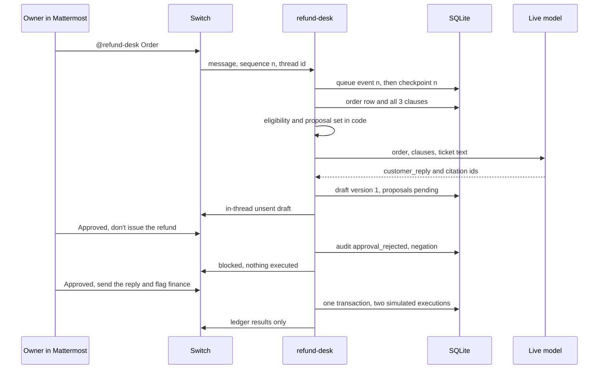

# System design — Refund Desk

## Components

| Piece | Where it runs | Role |
| --- | --- | --- |
| Switch server and Mattermost | Docker, via Switch Console, on Rohit's machine | Room, identity, bridge. Not vendored here. |
| `refund-desk` | Node 22, this repo | Protocol client, inbox, eligibility, one model call, gate, ledger, HTML page. |
| SQLite | `data/refund-desk.sqlite` | Gitignored. Agent is the only writer. |
| Model | OpenAI-compatible HTTPS | Wording only. OpenAI or Gemini, key from the environment. |

Console does not run this agent. Registration uses Rohit's registration key so he is the owner. The bootstrap key is refused: agents it creates belong to a dedicated account, and owner-only approval would then bind the wrong person.

## Flow

## Switch session

1. `GET /health` must be 200. The body, the base URL, and any version headers are written to `data/switch-discovery.json` with the op schema.
2. `POST /agents` with `SWITCH_REGISTRATION_KEY`. Never the bootstrap key. `overwrite` is not sent.
3. `POST /agents/{id}/ops/update_agent_detail` with `addressing: owner_only`.
4. Open `/agents/{id}/connection/ws` with a stable `connection_id`, `scope=single`, `filter=all`, and `rooms={SWITCH_ROOM_ID}` so the room is claimed as the socket opens.
5. Read `generation` from `connection_state`. Then call `read_context` with `X-Switch-Connection-Id` to load context. Do not wait until a later subscribe.
6. On every `ping`, reply `{"type":"pong","cursor":<resume_sequence>}` immediately. That cursor is the stream position, committed before the pong. A test drives 150 pings, the count in a 5-minute session at the documented 2-second interval.
7. Reconnect with the same `connection_id`, `start_from` set to `resume_sequence`, and `expected_generation`. Stop on `taken_over`.
8. Post with `post_message` and a non-null `thread_id`. If the live input schema has no thread field, exit and print the schema. There is no `POST /agents/{id}/message` fallback and no channel-root post.

`docs/switch-ops.expected.json` is the shape this client sends. A real Console may differ. Discovery is what Rohit records during the smoke test. This VM cannot see his Console version.

Room instructions live in `room/instructions.md`. Paste them before the first ticket. Reconnect the agent after pasting so it picks them up.

## Processing

Domain events carry a numeric `id`. Control frames do not.

- A numbered event is inserted into `inbox` as `queued` in the same transaction that advances `checkpoint.queued_sequence` (what we actually received) and `resume_sequence` (what the socket reports). The pong uses `resume_sequence` only after that commit.
- Existence of a row is not completion. A duplicate message id is ignored only when `state=completed`. The same sequence number in a later cursor epoch is a different event.
- On startup, rows left in `processing` return to `queued`. A failed send is requeued until five attempts, then marked failed.
- A `gap` does not change `queued_sequence`. Per the [connection docs](https://docs.switchagents.ai/switch-rooms/internals/agent-connection.md), `resume_sequence` becomes `resumed_at`, and the cursor epoch increments so a numbering reset cannot collide with an old sequence. `read_context` is parsed. If the source message or a live approval is missing from that history, the proposal version increments, older approvals are invalidated, and execution waits for a new proposal.
- The worker claims one queued row, does the work, then marks it `completed` only after the outbound post is sent.

## Decisions

Code loads every policy clause on each ticket. It does not search.

| Order facts | Result | Proposed actions |
| --- | --- | --- |
| `charge_count >= 2` and placed within 30 days of `DEMO_TODAY` (default `2026-11-06`) | `refund`, `eligible` | `send_reply`, `flag_finance`, `issue_refund` |
| Duplicate charge, outside the window | `refund`, `ineligible` | `send_reply` only |
| Single charge | `question`, `ineligible` | `send_reply` only |

Not proposing `issue_refund` is not a denial and is not a refusal. The row simply does not exist.

The model receives the order, all three clauses, and the ticket text. It may return `customer_reply`, `internal_note`, and `cited_chunk_ids`. It does not choose eligibility or the action set. Citation ids outside the three known ids are rejected, audited, and omitted. The thread shows the reply as `Unsent draft (not sent to the customer)`.

Sentences that claim an action happened are rendered from `actions` rows after commit. The wording is:

- `send_reply` — Simulated customer reply recorded. No email was sent.
- `flag_finance` — Simulated finance flag recorded. No finance system was contacted.
- `issue_refund` — Simulated refund record written. No payment was moved.

## Approval

A message approves only when all of these hold:

- The first line, after stripping one leading `@refund-desk`, is `Approved` or `Approved` plus an affirmative action list.
- The body has no negation and no question mark. `Approved, don't issue the refund` is a rejection.
- `thread_id` is non-null and equals the ticket's thread. The ticket stores the opening event's `thread_id`, or that event's `message_id` when the root post has a null thread. A null approval thread never matches.
- `sender_id` equals `SWITCH_OWNER_PARTICIPANT_ID`. Owner-only addressing is necessary and not sufficient. Until the env var is set, approvals fail with `owner_not_configured`.
- The action set is either the exact pending set (bare `Approved`) or a non-empty subset named affirmatively. An unknown action, or an action that is not pending, rejects the whole message.
- `proposal_version` on the approval equals `tickets.proposal_version`. Replacing the draft increments the version and sets `invalidated_at` on older approvals.

Execution, in one transaction: reload the approval and the ticket, recheck version, sender, thread, and pending actions, insert each `actions` row, mark those proposals `executed`, set `finance_note` or the order status when that action is in the set, then commit. A thrown error rolls the transaction back. The chat line is read back from the committed rows.

## Ledger page

The agent serves HTML on `127.0.0.1` only. The page refreshes itself and calls same-origin JSON. It contains no token and no secret. It shows the blocked audit reason and the simulated executions.

## Failure modes

| Case | Behavior |
| --- | --- |
| Bootstrap key | Register script exits. |
| `managed_by_controller` | Exit. Do not also create this name in Console. |
| Missing thread field in the live schema | Exit with the schema printed. No root post. |
| Model error | Post that the draft failed. Do not use the scripted fixture. Do not execute. |
| Negated or ambiguous approval | Audit the reason. Proposals stay pending. |
| Crash after queue, before work | Restart processes the queued row once. |
| Gap | Checkpoint unchanged. Context is re-read. |
| `taken_over` | Exit. A second process has the connection. |
