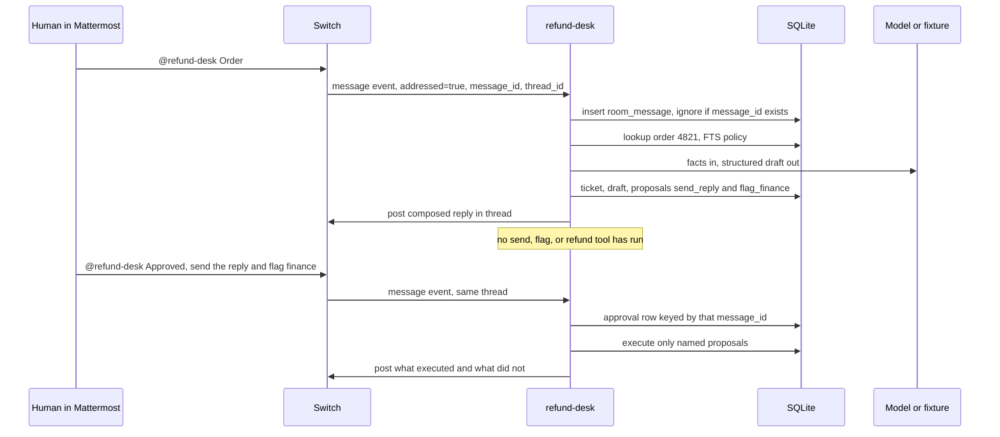

# System design — Refund Desk

Phase 2 builds this. Phase 1 does not add the processes below.

## Components

| Piece | Process | Responsibility |
| --- | --- | --- |
| Switch server | Docker, started by Switch Console | Rooms, identity, the Mattermost bridge, the agent API. We do not vendor or modify it. |
| Mattermost | Same Docker stack | The channel the human and the agent share. Bundled so the demo needs no company workspace. |
| `refund-desk` | Node 22, this repo | Protocol client, retrieval, one draft call, approval gate, ledger writes. |
| Board | Next.js, this repo | Read-only view of the ledger. Bound to `127.0.0.1`. Cannot approve. |
| SQLite file | `data/refund-desk.sqlite` | Orders, policy, tickets, approvals, actions. The agent is the only writer. |
| Model | HTTPS, optional | One chat-completions call when `LLM_MODE=live`. Absent in `scripted`. |

Console is the control plane for the server and the room. It is not the worker. Registering `refund-desk` through Console's New Agent form attaches an agent controller, and the server then refuses our WebSocket with `managed_by_controller`.

## Data flow



The board polls `GET /api/tickets/:id` on the agent. It is not on this diagram because it never writes.

## Switch integration

### Registration

Once per machine, with a registration key from the Gateway API Keys page:

`POST {SWITCH_BASE_URL}/agents`

```json
{
  "name": "refund-desk",
  "description": "Drafts refund replies and waits for an in-thread approval before any send, finance flag, or refund record.",
  "connector_type": "refund-desk",
  "integration_profile": {
    "connection_model": "always_on",
    "message_exchange": true,
    "pre_invocation_mediation": [],
    "post_invocation_mediation": [],
    "event_reporting": []
  }
}
```

Store `{id, api_key}` from the response. The key is not shown again. Do not register on every launch. `overwrite: true` rotates the key and breaks a running client.

Then, with the agent key, set addressing:

`POST /agents/{id}/ops/update_agent_detail`

```json
{ "agent_id": "{id}", "addressing": "owner_only" }
```

`owner_only` means a message is `addressed` only for the owner. That is the demo's human, after the Mattermost account is linked. Do not set `anyone`. A second participant could then approve a refund.

### Session

- Probe `GET /health` before connecting. A 401 is the wrong path, not a dead server.
- Open `ws(s)://{host}/agents/{id}/connection/ws?connection_id={stable uuid}&rooms={room id}&scope=single&filter=all&start_from=head`.
- On later reconnects, `start_from` is the last processed sequence and `expected_generation` is the last `connection_state.generation`.
- Answer every `ping` before handling the event that arrived with it. Pong body: `{"type":"pong","cursor":N}`.
- On `heartbeat_lapsed`, `no_stream`, `unfenced`, or `connection_error`, reopen. On `taken_over`, exit. Do not loop.
- On `gap`, call `read_context` for the room before drafting. Do not answer from a hole.
- Ignore `command` events. The demo does not use `!reset`.
- Ignore messages with `addressed: false`, messages whose sender is this agent, and events marked `com.switch.auto_reply` or `com.switch.admin`.
- Deduplicate on `payload.message_id`.

Room id: create the room in Console, invite `refund-desk`, copy the id into `SWITCH_ROOM_ID`. Phase 2 confirms whether `rooms=` at open is enough or whether `connect_to_room` is also required to get thread context. Prefer declaring the room on the open URL so catch-up is not skipped.

### Posting

Prefer the `post_message` operation when its live schema (from `GET /agents/{id}/ops`) accepts a thread id, so the reply stays in the ticket thread. Until that schema is dumped, the documented fallback is:

`POST /agents/{id}/message` with `{ "room_id", "content" }`.

That fallback may land at the channel root. The filmed demo is worse if it does. Dumping the schema is the first build task, not a polish task. The client must send `X-Switch-Connection-Id` on operation calls. Arguments are the bare object, not wrapped. Unexpected keys are rejected.

The human's approval message must `@refund-desk`. Follow-ups (untagged replies in a thread) are off unless the server flag is on. Do not depend on them.

### Room instructions

Paste into the room. An agent already connected keeps the previous copy until it reconnects, so paste these before the first real ticket.

```
This room handles refund tickets for Northwind Goods. It is a demo shop; nothing here charges a card or emails a customer.

When a person addresses you with a ticket:
- Reply in that thread, in under 8 lines.
- Restate the issue in one line and label it refund, bug, question, or feature.
- Use the order id in the message. If it is missing, ask for it and stop.
- Cite the policy heading you used. Do not invent a clause.
- End with the exact actions waiting for approval.
- Never write that you sent, flagged, or refunded something unless this process has just done that action.

You do not decide that an approval is enough. The person approves by addressing you with a message that starts with "Approved".
```

The instructions are a briefing. The gate does not read them to decide.

### What we will not ask Switch to do

No Switch Trust redaction, no roles, no second agent, no room document as the system of record. The ledger is the record. The thread is the human-readable copy. A room document can be added after submit; it is not how the gate works.

## LLM and tools

Facts are loaded in code. The model does not pick tools.

1. Regex `\b\d{3,6}\b` after the word `order` (case insensitive), else the first standalone 3–6 digit token. `#4821` hits this. If none, the agent asks for an order id and does not call the model.
2. `lookup_order(orderId)` reads the seed table. Unknown id: ask the human, do not invent an order.
3. `search_policy(ticketText)` queries FTS5 over the policy chunks and returns the top two headings and bodies.
4. One completion, response shaped as JSON:

```json
{
  "label": "refund",
  "eligibility": "eligible",
  "summary": "Order 4821 was charged twice and is inside the 30-day window.",
  "customer_reply": "…",
  "internal_note": "…",
  "cited_chunk_ids": ["duplicate-charge"],
  "proposed_actions": ["send_reply", "flag_finance"]
}
```

`proposed_actions` is filtered to the known set. The model cannot add a new action name. For an ineligible order the fixture proposes no refund action.

`LLM_MODE=scripted` returns a fixture keyed by order id and never opens a socket to a provider. `live` sends the order row, the chunks, and the ticket text to `{LLM_BASE_URL}/chat/completions` with `response_format` json_object when the provider accepts it, temperature 0, and a 20s timeout. On timeout or invalid JSON the agent posts `I couldn't draft that. Say it again.` and writes an audit row. It does not execute tools.

The text posted to Mattermost is built by a template in our code:

- lines from `summary`, `label`, cited headings, `customer_reply`
- `Pending approval: send_reply, flag_finance.`
- after execution, a second template lists `executed` and `not executed`

The model's string is never posted raw. A draft that says "I have refunded this" cannot reach the channel.

### Tools that change state

Each one takes `ticketId` and `approvalId` and re-checks the ledger inside the function:

| Tool | Effect on success | Denied when |
| --- | --- | --- |
| `send_customer_reply` | Insert action `executed`. No outbound email. | No approval for this ticket names `send_reply`, or the approval's thread/message does not match. |
| `flag_finance` | Insert action `executed` and a one-line finance note on the ticket. | Same, for `flag_finance`. |
| `issue_refund` | Insert action `executed`, set the order's local status to `refund_recorded`. No payment call. | Same, for `issue_refund`. The demo approval does not name it. |

Denial inserts an action row with `outcome=denied` and returns the reason. It does not throw past the orchestrator. The orchestrator posts the denial only when a human asked for that action, or when a test calls the tool. A successful proposal path does not call `issue_refund` at all.

Read-only helpers (`lookup_order`, `search_policy`) are not gated.

## Human-approval guardrails

An approval is created only from a Switch `message` event that:

1. Has `addressed: true` (Switch already applied `owner_only`).
2. Has a `thread_id` equal to the ticket's thread, when the ticket has one.
3. Has a `message_id` not already stored.
4. Has a body whose first non-empty line matches `^approved\b` (case insensitive).
5. Names one or more of `send_reply`, `flag_finance`, `issue_refund`, **or** names none, in which case the names are the ticket's still-pending proposals.

`looks good`, `yes`, `ship it`, and a ticket body that contains the word `Approved` do not match. The customer-approval claim is data in the ticket, not an event, so it cannot create a row.

The approval stores `message_id`, `sender_id` (opaque, compared for equality only), and the verbatim body. Tools join to that row. There is no REST route that inserts an approval. Restarting the process does not grant one.

Idempotency: a second delivery of the same `message_id` hits the unique key and does not run the tools again. Running an already `executed` proposal is a no-op that returns the existing row.

## Observability

- stdout JSON lines: `ts`, `level`, `event`, `ticket_id`, `message_id`. No API keys, no full prompts.
- `audit_events` for ticket created, draft stored, approval stored, action executed, action denied, model failed.
- `llm_calls` stores provider, model, latency, a hash of the prompt, and the structured response. Not the raw prompt.
- If `LANGFUSE_PUBLIC_KEY` and `LANGFUSE_SECRET_KEY` are both set, emit one trace per ticket. If they are unset, do nothing. The demo must not require Langfuse.
- The board is the view a judge sees. The room transcript is the view the human sees. They are fed by the same rows.

## Deployment

Local only.

- Console + Docker: Switch and Mattermost, as the docs describe. We do not write a compose file for them.
- Agent: `node` on the host, so it can reach `localhost` on the bridge port Console picked. That port goes in `SWITCH_BASE_URL` (example `http://127.0.0.1:8000`; the real port is whatever Console bound).
- Board: `next dev` or `next start` on `127.0.0.1:3000`, calling the agent at `http://127.0.0.1:8787`.
- Secrets in `.env`, not in git: registration key, agent key, optional LLM key. `.env.example` lists the names with empty values.

A public URL is out of scope. Publishing the board without the room would also fail the rubric, because the workflow would appear to run with Switch removed.

## Failure modes

| Failure | What the human sees | What we do |
| --- | --- | --- |
| Docker or Console down | Agent logs `bridge health failed` and exits | Do not film. README says start Console first. |
| 4401 on the socket | Agent exits `bad agent key` | Re-copy the key. Do not re-register unless the key is lost. |
| 409 on register | Agent already exists | Keep the saved key. |
| `managed_by_controller` | Agent exits with that code | Delete the Console-created twin, or register under this name only via the API. |
| Account not linked | Room reply that it cannot tell who you are | Link Mattermost on the server Home page. This is not a prompt bug. |
| Heartbeat lapse | Short silence, then the agent is back | Reconnect from the cursor. |
| `taken_over` | Process exits | A second `npm run agent` is running. Stop one. |
| Gap | Agent re-reads context, then answers | Do not draft from memory of a missed message. |
| Model timeout / bad JSON | `I couldn't draft that. Say it again.` | No proposals, no tools. |
| Approval in the wrong thread | Agent says which thread it is waiting on | Do not execute. |
| Tool called without a row | Ledger `denied`, test fails if a send happened | Fail closed. |
| Process crash after approval insert, before tools | On startup, scan approvals whose proposals are still `pending` and do not auto-run them | The human repeats the approval. Auto-resume of a refund is the wrong default. |
| Duplicate message | Nothing new | Unique `message_id`. |
